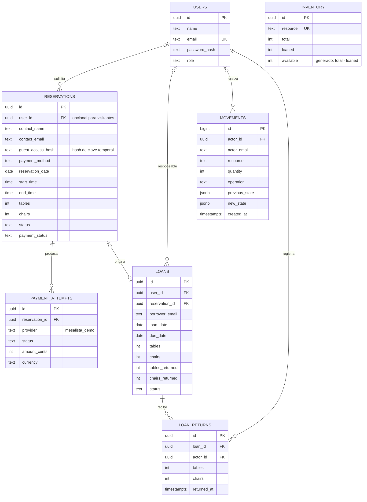
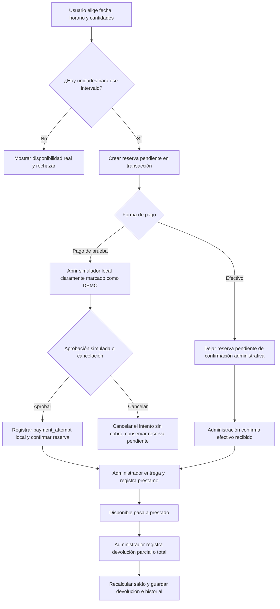

# MesaLista

Aplicación web responsive para administrar mesas y sillas, sus reservas, préstamos, devoluciones parciales e historial. La fuente persistente es PostgreSQL; el proyecto puede conectarse a una base Neon usando `DATABASE_URL`.

## 1. Arquitectura

- **Frontend:** React + Vite; interfaz en español, responsive y accesible desde escritorio, tabletas y teléfonos.
- **Backend:** API REST con Express. Valida permisos y reglas de negocio; las operaciones que modifican disponibilidad usan transacciones PostgreSQL y bloqueos de inventario.
- **Base de datos:** PostgreSQL/Neon. Las unidades físicas son una única fuente de verdad: `inventory.total` y `inventory.loaned`. Las reservas se calculan a partir de las reservas activas que coinciden con la fecha y horario solicitados; no se duplica el saldo en el cliente.
- **Autenticación:** contraseñas con bcrypt y tokens JWT de 12 horas. El rol vigente se consulta en la base de datos, así que un cambio de permisos aplica también a sesiones existentes.
- **Reservas sin cuenta:** cualquier persona puede enviar una solicitud con su correo sin crear usuario. Solo administración puede consultar esos registros; una clave aleatoria temporal permite completar el pago de prueba, pero no consultar ni cancelar reservas.
- **Pagos:** permite registrar efectivo pendiente de confirmación administrativa y un simulador local `MesaLista Pay`. La simulación no cobra, no se conecta a PayPal ni solicita tarjetas.
- **Correos de reserva y pago:** al registrar una reserva, envía sus datos y el estado del pago al correo de la cuenta seleccionada; al confirmar el pago, envía un comprobante HTML mediante la API HTTPS de Resend. Si falla el envío, la reserva o el pago quedan guardados y el mensaje se puede reintentar desde Reservas.
- **Apariencia:** identidad visual monocromática de alto contraste con acento lima, tipografía geométrica y selector de tema claro/oscuro guardado localmente.

## 2. Entidades y relaciones



El esquema SQL completo y los inventarios iniciales (120 mesas y 120 sillas) están en [`server/db/schema.sql`](./server/db/schema.sql). Al conectarlo a una base ya inicializada, el `ON CONFLICT DO NOTHING` conserva las cantidades existentes; los cambios al inventario deben hacerse desde la administración para que queden registrados en el historial.

## 3. Flujos principales



- Una reserva ocupa recursos en la fecha/horario solicitado; dos horarios no se solapan si ambos tienen inicio y fin definidos. Las reservas sin horario ocupan todo el día.
- Los recursos prestados se restan del saldo físico hasta su devolución. Una devolución parcial solo libera la cantidad efectivamente recibida.
- Una reserva pagada puede convertirse en préstamo desde la pantalla de reservas del administrador.
- Los pagos en efectivo quedan pendientes hasta que administración confirme la recepción. Las reservas de usuarios registrados conservan el correo de la cuenta; administración puede seleccionar una cuenta registrada al crear una reserva.
- Las reservas sin cuenta se vinculan por correo. Administración puede seleccionar ese correo al registrar un préstamo; no se crea una cuenta ni se concede acceso público a la reserva.
- Para impedir inconsistencias, la disponibilidad se vuelve a verificar en el servidor dentro de la transacción; el cálculo de la interfaz no sustituye esa validación.

## 4. API

Las rutas de gestión requieren una sesión autenticada, salvo registro, inicio de sesión, salud y el grupo limitado de reservas sin cuenta.

| Área | Rutas principales |
|---|---|
| Autenticación | `POST /api/auth/register`, `POST /api/auth/login`, `GET /api/me` |
| Resumen/disponibilidad | `GET /api/dashboard`, `GET /api/availability?date=YYYY-MM-DD&startTime=HH:mm&endTime=HH:mm` |
| Reservas sin cuenta | `GET /api/guest/availability`, `POST /api/guest/reservations`, `POST /api/guest/reservations/:id/demo-payment` |
| Pago de prueba sin cuenta | `POST /api/guest/payments/demo/complete`, `POST /api/guest/payments/demo/cancel` (clave temporal de pago; sin consulta ni cancelación pública) |
| Efectivo | `POST /api/reservations/:id/cash-payment/confirm` (admin confirma la recepción, registra el movimiento y envía el comprobante) |
| Inventario (admin) | `PATCH /api/inventory/:resource` |
| Reservas | `GET /api/reservations`, `POST /api/reservations`, `POST /api/reservations/:id/cancel` |
| Simulación de pago | `POST /api/reservations/:id/demo-payment`, `POST /api/payments/demo/complete`, `POST /api/payments/demo/cancel` |
| Reenvío de correos | `POST /api/reservations/:id/reservation-email` (confirmación) y `POST /api/reservations/:id/receipt-email` (comprobante de reservas pagadas); titular o admin |
| Préstamos | `GET /api/loans`, `POST /api/loans`, `POST /api/loans/from-reservation/:id` |
| Devoluciones (admin) | `POST /api/loans/:id/returns` |
| Historial/usuarios (admin) | `GET /api/movements`, `GET /api/users`, `PATCH /api/users/:id/role` |
| Diagnóstico | `GET /api/health` |

## 5. Roles y permisos

- **Usuario:** consultar inventario y disponibilidad por fecha; reservar; consultar sus reservas y préstamos; cancelar solicitudes cuyo pago aún no se completó.
- **Visitante sin cuenta:** consultar disponibilidad, reservar y completar el pago de prueba temporalmente con su correo. No puede consultar ni cancelar el registro después; administración gestiona el ciclo posterior.
- **Administrador:** funciones de usuario más ajustes de inventario, confirmación de efectivo recibido, registro de préstamos, conversión de reserva pagada a préstamo, devoluciones parciales/totales, historial y administración de roles. Se protege el último administrador y no se permite cambiar el propio rol.
- El registro público siempre crea cuentas `user`; el rol `admin` se asigna mediante el comando de bootstrap o desde la pantalla de administración.

## 6. Reglas de negocio

1. Cantidades enteras no negativas; cada reserva/préstamo/devolución debe incluir al menos una unidad.
2. La fecha no puede estar en el pasado; el horario debe estar completo y su fin debe ser posterior al inicio.
3. La disponibilidad se comprueba con bloqueo transaccional y se descuenta el inventario prestado; el esquema impide que los préstamos superen el total.
4. Las reservas activas cuentan solo en su fecha e intervalo. Un préstamo nuevo se valida contra reservas existentes durante todo el período hasta la devolución prevista.
5. Solo se convierten en préstamo desde una reserva las solicitudes confirmadas y pagadas. Una reserva pagada no se cancela. La cancelación y la captura se serializan para que no se cobre una reserva que fue liberada.
6. No se devuelve más que el saldo pendiente. Cada devolución se guarda en `loan_returns`, actualiza el préstamo y registra movimientos con usuario, fecha, operación y estados anterior/posterior.
7. Las tarifas por unidad y día son configurables en centavos; la pantalla actual reserva un día calendario.
8. Las reservas pagadas en efectivo no se marcan como pagadas hasta que una persona administradora confirme el dinero recibido.

## 7. Estructura del proyecto

```text
src/
  main.jsx             # Interfaz, páginas, formularios y estado del cliente
  styles.css           # Diseño responsive
public/
  venue.svg            # Ilustración original de mesas y sillas
server/
  db/schema.sql        # Esquema PostgreSQL y datos iniciales
  src/
    db.js              # Pool Neon/PostgreSQL y transacciones
    auth.js            # Hash, JWT y autorización por rol
    index.js            # API REST, transacciones de negocio y simulador demo
    seed-admin.js       # Alta segura del administrador inicial
.env.example            # Plantilla de configuración local
```

## 8. Inicio local y configuración de Neon

1. Crea un proyecto y una base de datos en Neon; copia su cadena PostgreSQL con SSL.
2. Instala dependencias y prepara la configuración:

   ```bash
   npm install
   cp .env.example .env
   ```

3. En `.env`, define `DATABASE_URL`, un `JWT_SECRET` aleatorio de al menos 32 caracteres, y `ADMIN_NAME`, `ADMIN_EMAIL` y `ADMIN_PASSWORD` (mínimo 12 caracteres). Rota primero las contraseñas de base de datos que hayas compartido como imágenes; introduce la nueva cadena directamente en `.env`, no en el chat.
4. El pago integrado es únicamente una simulación local. En `.env`, cambia `PAYMENT_CURRENCY` si corresponde. No cobra dinero, no se conecta a PayPal ni debe usarse en producción como comprobante real.
5. Para enviar correos, crea una cuenta en Resend, verifica el dominio del remitente y configura `RESEND_API_KEY` y `RECEIPT_FROM` en `.env`. No compartas la clave ni la guardes en Git.
6. Arranca el servidor para crear o actualizar el esquema de forma idempotente y luego, en otra terminal, crea el administrador:

   ```bash
   npm run dev
   npm run db:admin
   ```

7. Abre `http://localhost:5173`. El servidor de interfaz reenvía `/api` a Express en `http://localhost:3001`.

Las tarifas de ejemplo en `.env.example` son **10.00 USD por mesa y 5.00 USD por silla por día**. El total se calcula a partir de las cantidades seleccionadas. El simulador sirve para verificar el flujo y las actualizaciones del inventario, pero no acepta pagos reales.

## 9. Publicar en Vercel

El repositorio incluye `vercel.json` y una función Node.js que adapta Express a Vercel Functions. Vercel compila React/Vite como sitio estático y sirve `/api/*` desde la misma URL; las rutas API anidadas se reescriben a la función común conservando la ruta original para Express. No se necesita un servidor Express permanente.

1. Sube el proyecto a un repositorio Git privado o público e impórtalo en Vercel. Vercel detecta el proyecto; los comandos configurados son `npm run build` y el directorio de salida `dist`.
2. En **Project → Settings → Environment Variables**, define para Production (y Preview si la usarás):
   - `DATABASE_URL`: cadena de conexión PostgreSQL de Neon. Usa la URL de Neon con SSL; se recomienda la cadena **pooled** para las funciones serverless.
   - `JWT_SECRET`: secreto aleatorio de al menos 32 caracteres. No reutilices contraseñas ni lo publiques.
   - `WEB_ORIGIN`: origen completo del dominio de producción, por ejemplo `https://tu-dominio.vercel.app`. Se admiten varios orígenes separados por comas. Vercel permite automáticamente el dominio del deployment actual y el dominio de producción del proyecto.
   - `PRICE_TABLE_CENTS=1000`, `PRICE_CHAIR_CENTS=500` y `PAYMENT_CURRENCY=USD`.
   - `RESEND_API_KEY`: clave privada de Resend.
   - `RECEIPT_FROM`: remitente de un dominio verificado en Resend, por ejemplo `MesaLista <comprobantes@tudominio.com>`.
3. Haz el primer deployment. La primera solicitud a `/api/health` crea o actualiza el esquema en Neon bajo un bloqueo transaccional; la ruta debe responder `{"status":"ok","database":"connected",...}`.
4. Crea la cuenta administradora una sola vez desde un entorno seguro con `DATABASE_URL` apuntando a la misma base Neon. Define `ADMIN_NAME`, `ADMIN_EMAIL` y `ADMIN_PASSWORD` (mínimo 12 caracteres) en tu `.env` local y ejecuta `npm run db:admin`. No guardes el `.env` en Git ni configures esas credenciales de bootstrap como variables públicas del frontend.
5. Prueba el inicio de sesión, una reserva y el historial en el dominio publicado. Añade el dominio personalizado en Vercel y en `WEB_ORIGIN` si corresponde; cambia las variables en Vercel y redepliega para aplicarlas.

El esquema se inicializa en el primer request de cada instancia cálida y serializa las migraciones con un advisory lock de PostgreSQL. Las funciones limitan el pool a una conexión por instancia para reducir el consumo de conexiones de Neon. `.env` y los demás archivos locales `.env.*` (excepto `.env.example`) están excluidos de Git.

## 10. Limitaciones operativas

- Los pagos son simulados y no producen cobros, transferencias ni recibos financieros válidos. Integra un proveedor oficial antes de aceptar reservas de producción.
- El efectivo es un registro manual: no verifica ni recibe dinero por sí mismo. Administración solo debe confirmarlo después de recibirlo.
- Antes de anunciar el sitio como servicio financiero o de reservas con cobro real, integra un proveedor oficial y añade medidas operativas contra abuso de reservas públicas.
- Los préstamos y devoluciones son operaciones administrativas. Las devoluciones parciales conservan el saldo pendiente por recurso.
- El dashboard presenta como resumen la disponibilidad de la fecha actual; el formulario de reserva solicita la disponibilidad exacta para la fecha y, cuando se indican ambas horas, el intervalo escogido.
